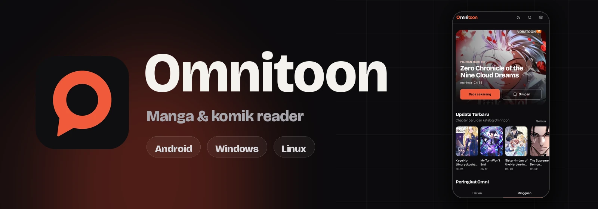
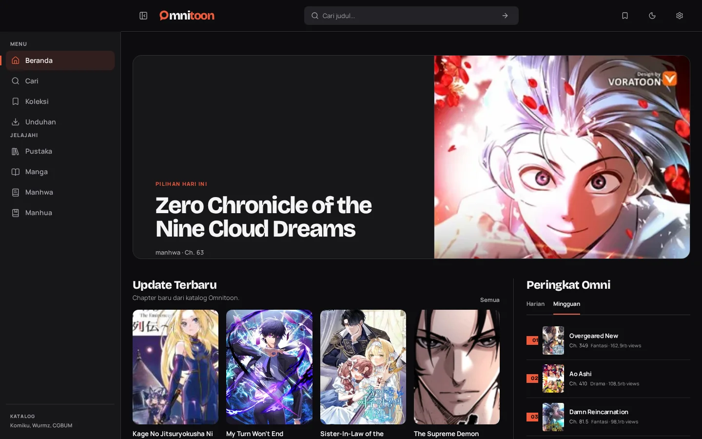
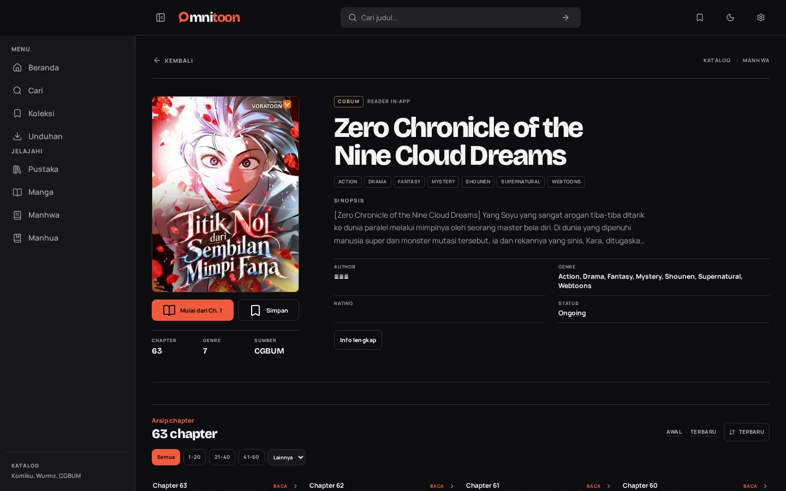
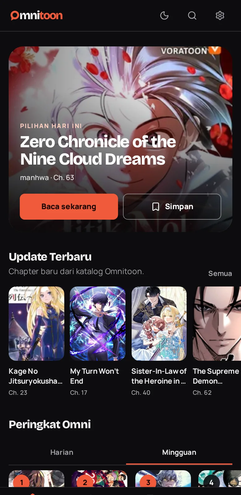
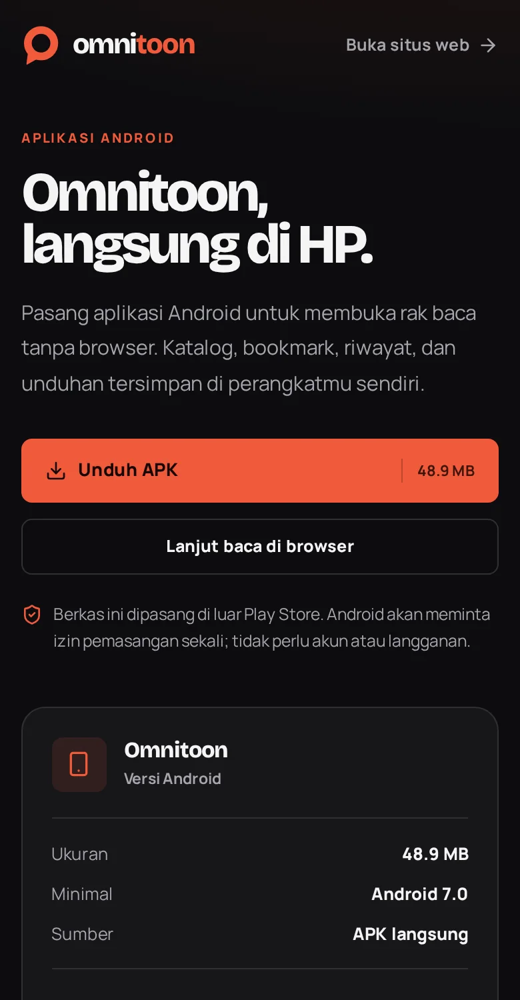

<p align="center">
  
</p>

<p align="center">
  <a href="https://github.com/uznbt/omnitoon/releases/latest"></a>
  <a href="https://github.com/uznbt/omnitoon/releases"></a>
  
  
  
</p>

<h3 align="center">Rak baca manga dan komik, langsung di perangkatmu.</h3>

<p align="center">
  Omnitoon menyatukan katalog <b>Komiku</b>, <b>Wurmz</b>, dan <b>CGBUM</b> dalam satu aplikasi.
  Backend Rust berjalan lokal, katalog tertanam di paket, dan chapter bisa dibaca
  lewat browser, desktop, atau HP Android.
</p>

<p align="center">
  <a href="https://github.com/uznbt/omnitoon/releases/latest">
    
  </a>
</p>

## Kenapa Omnitoon?

| | Fitur | Keterangan |
|:---:|---|---|
| 📚 | **Satu rak, banyak sumber** | Katalog Komiku, Wurmz, dan CGBUM dalam satu antarmuka. |
| 📖 | **Reader yang nyaman** | Mode baca vertikal, riwayat chapter, dan bookmark tersimpan lokal. |
| 📥 | **Baca tanpa internet** | Unduh chapter ke perangkat dan buka lagi kapan saja. |
| 🖼️ | **Proxy gambar** | Cover dan halaman dimuat lewat backend sendiri agar tidak kena hotlink. |
| ⚡ | **Backend Rust** | Server lokal ringan, cepat, dan tidak butuh server terpisah. |
| 🔄 | **Pembaruan terverifikasi** | Unduhan APK bisa dilanjutkan, dicek SHA-256, lalu dipasang dari cache lokal. |
| 🌐 | **Mirror opsional** | Bagikan rak bacaan lewat Cloudflare Tunnel langsung dari HP atau desktop. |

## Tampilan

| Beranda desktop | Detail manga |
|:---:|:---:|
|  |  |

<table align="center">
  <tr>
    <td align="center"></td>
    <td align="center"></td>
  </tr>
</table>

## Unduhan

> [!TIP]
> Belum tahu harus pilih APK yang mana? Ambil **Omnitoon-universal.apk**.
> APK ini berisi arm64-v8a dan armeabi-v7a, jadi cocok untuk hampir semua HP.

### 🤖 Android

| Berkas | Cocok untuk | Ukuran |
| --- | --- | ---: |
| [Omnitoon-universal.apk](https://github.com/uznbt/omnitoon/releases/latest/download/Omnitoon-universal.apk) | Hampir semua HP. Pilih ini kalau ragu. | ±100 MB |
| [Omnitoon-arm64-v8a.apk](https://github.com/uznbt/omnitoon/releases/latest/download/Omnitoon-arm64-v8a.apk) | HP Android 64-bit ARM modern. | ±51 MB |
| [Omnitoon-armeabi-v7a.apk](https://github.com/uznbt/omnitoon/releases/latest/download/Omnitoon-armeabi-v7a.apk) | HP Android 32-bit ARM yang lebih lama. | ±50 MB |
| [Omnitoon-x86_64.apk](https://github.com/uznbt/omnitoon/releases/latest/download/Omnitoon-x86_64.apk) | Emulator x86_64. Statusnya eksperimental. | ±53 MB |

Minimal Android 7.0 (`minSdk 24`). APK dipasang di luar Play Store, jadi Android
akan meminta izin pemasangan sekali.

### 🪟 Windows

| Berkas | Keterangan |
| --- | --- |
| `Omnitoon_<versi>_x64-setup.exe` | Installer NSIS |
| `Omnitoon_<versi>_x64_en-US.msi` | Installer MSI |
| `Omnitoon-<versi>-windows-x64-portable.zip` | Versi portable |
| [Omnitoon-desktop.exe](https://github.com/uznbt/omnitoon/releases/latest/download/Omnitoon-desktop.exe) | Binary langsung tanpa installer |

> [!WARNING]
> Paket Windows belum ditandatangani. SmartScreen bisa menampilkan peringatan.
> Verifikasi checksum dulu, lalu pilih **More info → Run anyway** hanya jika
> berkasnya cocok.

### 🐧 Linux

| Berkas | Distro |
| --- | --- |
| `Omnitoon_<versi>_amd64.deb` | Debian, Ubuntu, Kali, Linux Mint |
| `Omnitoon-<versi>-1.x86_64.rpm` | Fedora, openSUSE |
| `Omnitoon_<versi>_amd64.AppImage` | Semua distro x86_64 |
| `Omnitoon-<versi>-linux-x86_64-portable.tar.gz` | Semua distro x86_64 |
| `omnitoon-bin-<versi>-1-x86_64.pkg.tar.zst` | Arch, Manjaro |

Contoh pemasangan (ganti `0.1.8` dengan versi terbaru):

```sh
# Debian/Ubuntu
sudo apt install ./Omnitoon_0.1.8_amd64.deb

# Fedora/openSUSE
sudo dnf install ./Omnitoon-0.1.8-1.x86_64.rpm

# Arch/Manjaro
sudo pacman -U omnitoon-bin-0.1.8-1-x86_64.pkg.tar.zst

# AppImage
chmod +x Omnitoon_0.1.8_amd64.AppImage
./Omnitoon_0.1.8_amd64.AppImage
```

## Memasang di Android

1. Unduh `Omnitoon-universal.apk` dari halaman rilis.
2. Izinkan browser atau pengelola berkas memasang aplikasi dari sumber tidak dikenal.
3. Buka APK dan tunggu proses pemasangan selesai.
4. Untuk pembaruan berikutnya, buka **Pengaturan → Periksa pembaruan**.

APK memakai keystore yang sama antar rilis supaya versi baru bisa dipasang di
atas versi lama. Jangan menimpa Omnitoon dengan APK yang ditandatangani kunci
berbeda.

> [!NOTE]
> Pengguna v0.1.7 perlu memasang v0.1.8 secara manual satu kali. Setelah itu
> pembaruan dalam aplikasi memakai server lokal yang mendukung resume dan
> verifikasi SHA-256.

## Verifikasi checksum

Setiap rilis menyertakan dua berkas checksum:

- [SHA256SUMS.txt](https://github.com/uznbt/omnitoon/releases/latest/download/SHA256SUMS.txt) untuk semua aset rilis
- [SHA256SUMS-apk.txt](https://github.com/uznbt/omnitoon/releases/latest/download/SHA256SUMS-apk.txt) khusus keempat APK Android

Linux dan macOS:

```sh
sha256sum -c SHA256SUMS.txt
sha256sum -c SHA256SUMS-apk.txt
```

Windows PowerShell:

```powershell
Get-FileHash .\Omnitoon-universal.apk -Algorithm SHA256
```

Bandingkan hasilnya dengan isi berkas checksum. Jangan pasang berkas yang
hash-nya tidak cocok.

## Pembaruan aplikasi

- **v0.1.8 dan setelahnya:** aplikasi meminta server lokal mengunduh APK dari
  repositori ini. Unduhan bisa dilanjutkan setelah terputus, disimpan per tag,
  diverifikasi SHA-256, lalu disajikan ke Android lewat loopback.
- **v0.1.7 dan sebelumnya:** pembaruan masih memakai jalur langsung GitHub.
  Jika unduhan terpotong, pasang APK v0.1.8 secara manual satu kali.

Endpoint pembaruan dan `/api/apk` hanya melayani loopback, bukan dari domain
publik.

## Keamanan

> [!WARNING]
> APK node berisi token Cloudflare Tunnel yang tertanam. Token dienkripsi di
> dalam vault, tetapi tetap bisa diekstrak dari perangkat.

- Simpan APK hanya di perangkat tepercaya dan jangan mengunggahnya kembali ke
  hosting publik. Jika token bocor, segera ganti token tunnel.
- Tunnel tidak menyala otomatis. Aktifkan mirror node lewat **Pengaturan** saat
  ingin membagikan situs.
- Ingress Cloudflare harus diarahkan ke `http://127.0.0.1:8080`.
- Katalog `play.db.omz` tertanam di paket dan disemai ke folder data saat
  pertama dijalankan, jadi tidak perlu mengunduh database terpisah.

## Dibangun dengan

<p>
  
  
  
  
</p>

Server lokal berjalan di `http://127.0.0.1:47821`. Aplikasi desktop juga
membuka `127.0.0.1:8080` untuk cloudflared.

## Isi repositori

Repositori ini hanya berisi aset rilis. Setiap tag `v*` di repositori sumber
dicerminkan ke sini oleh workflow rilis. Jangan menambahkan kode sumber atau
berkas lain ke repositori ini.

## Lisensi

Omnitoon adalah perangkat lunak **proprietary** (closed source). Binary boleh
diunduh dan dipakai untuk penggunaan pribadi; redistribusi, penjualan, dan
rekayasa balik tidak diizinkan. Ketentuan lengkap ada di [LICENSE](LICENSE).

Manga, cover, dan materi pihak ketiga tetap milik sumber masing-masing.
